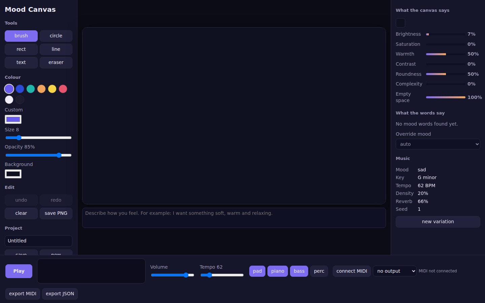
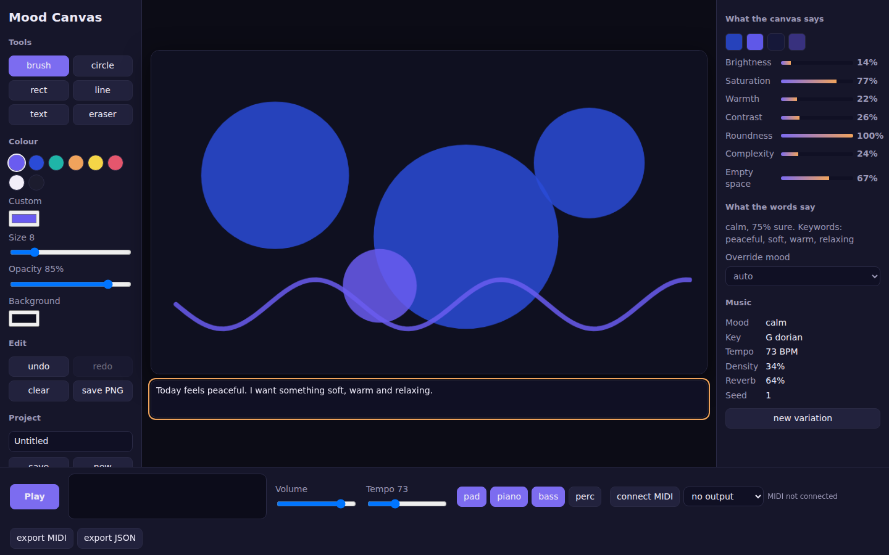
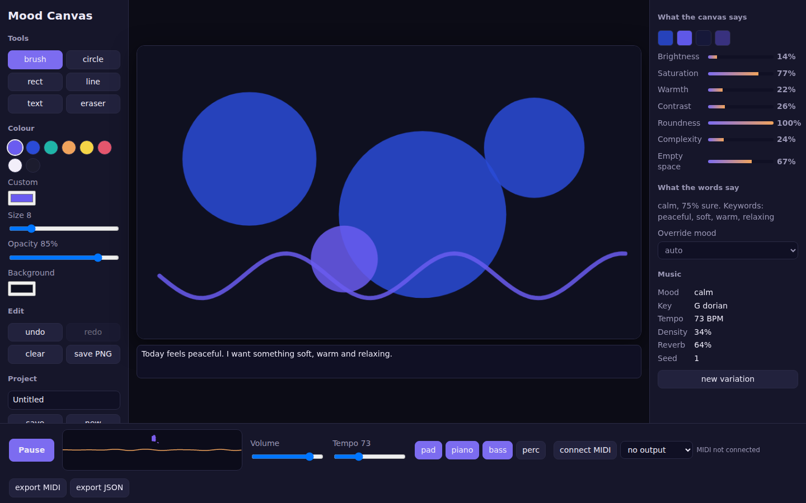
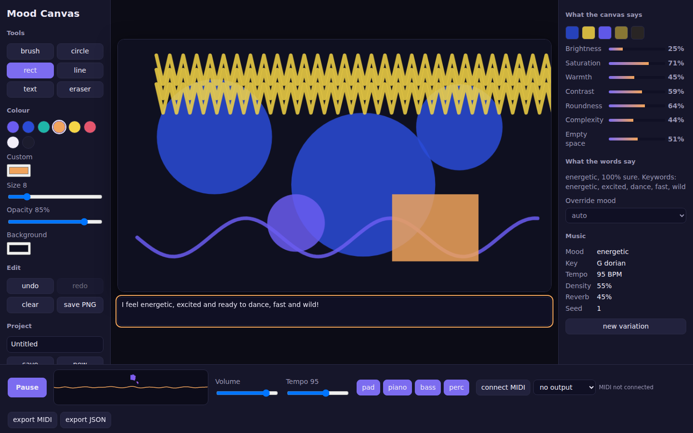

# Mood Canvas

Mood Canvas is a browser-based drawing and ambient-music application. Create a visual moodboard, describe how you feel, and generate a musical response from the canvas and text. Playback, visual analysis, and MIDI export run in the browser. An optional FastAPI service provides a separate SQLite-backed API for storing moodboard data; the current frontend keeps its own projects in browser `localStorage`.

## Features

- Draw with a brush, eraser, circles, rectangles, lines, or text.
- Choose a palette color or select custom colors, brush size, opacity, and canvas background.
- Undo and redo edits; clear the board; save a PNG snapshot.
- Save, open, duplicate, and delete projects in browser `localStorage`.
- Analyze canvas color and shape properties, and score mood-related words in the note and canvas text.
- Generate seeded ambient music whose mood, tempo, key, scale, density, and effects respond to visual and text analysis.
- Adjust mood, tempo, volume, and instrument layers while music is playing.
- Export the generated music as MIDI or export its music configuration as JSON.
- Connect MIDI input/output when supported by the browser.
- Optionally run the FastAPI/SQLite service for CRUD operations on moodboards.

## Requirements

- Node.js and npm for the frontend. The Vite development server and production build require a Node version compatible with the installed Vite release.
- Python 3.10 or newer is recommended for the backend.
- A modern browser with Canvas and Web Audio support. Click **Play** to allow the browser to start audio.
- Web MIDI is browser-dependent and generally requires a supported Chromium-based browser and a secure context (localhost qualifies).

## Run the frontend

Open a terminal at the repository root:

```powershell
cd frontend
npm install
npm run dev
```

Open the local URL printed by Vite (normally `http://localhost:5173`). Click **Play** after the page loads; browsers require a user gesture before audio can start.

Useful frontend commands, run from `frontend/`:

```powershell
npm run dev       # Start the development server
npm test          # Run the Vitest suite
npm run build     # Type-check and create a production build in dist/
npm run preview   # Preview the production build locally
```

## Run the optional backend

From the repository root, create and activate a Python virtual environment, then install the backend requirements:

```powershell
cd backend
python -m venv .venv
.\.venv\Scripts\Activate.ps1
python -m pip install -r requirements.txt
uvicorn app.main:app --reload
```

The API is normally available at `http://localhost:8000`. Interactive API documentation is at `http://localhost:8000/docs`; the OpenAPI schema is at `http://localhost:8000/openapi.json`.

On macOS or Linux, activate the virtual environment with:

```sh
source .venv/bin/activate
```

The backend is optional and is not required for browser drawing, analysis, playback, or local project management. Its API is a standalone persistence service; the current frontend project actions use `localStorage` rather than making API calls.

## Using the app

1. Use the left panel to select a drawing tool and color, and adjust size, opacity, or background.
2. Draw on the canvas. Select **text** to add a short text element; write a mood note in the text area beneath the canvas.
3. Review the canvas analysis and detected mood in the right panel. The text classifier is a keyword-based hint, so select an **Override mood** when needed.
4. Press **Play** to start the generated music. Use the player controls to change tempo, volume, and enabled instrument layers.
5. Use **undo**, **redo**, and **clear** while editing. Save a project to keep it in this browser, or save PNG to export an image.
6. Use **export MIDI** to download a MIDI file, or **export JSON** to download the current music configuration.
7. Use the project list to reload, duplicate, or remove locally saved boards.

Projects are stored by the browser under the `mmc.projects` localStorage key. They are local to the browser profile and site origin; clearing site data or using another browser/profile does not transfer them.

## How it works

### Canvas and visual analysis

The canvas is a 960 × 560 drawing surface rendered with the browser Canvas API. Color analysis samples canvas pixels and calculates brightness, saturation, warmth, contrast, palette, balance, and empty space. Shape analysis estimates roundness and complexity from drawn elements. Analysis is debounced and runs approximately 400 ms after a drawing change.

### Text mood analysis

The note and text elements are matched against a small emotion keyword list. The result includes a detected emotion, confidence, sentiment, intensity, and matched keywords. This is a lightweight heuristic, not a language model or a definitive sentiment assessment. Use the mood override if the detected result does not fit.

### Music generation and playback

Rules combine visual features and optional text mood into a `MusicConfig` containing mood, tempo, key, scale, density, energy, effects, chord progression, enabled layers, and seed. The composer uses the seed and bar index to generate repeatable notes constrained to the selected scale. Tone.js schedules browser audio; updates to generated notes are applied at bar boundaries, while effects and tempo are ramped.

### MIDI and exports

MIDI export creates a Standard MIDI File in the browser from the generated configuration. MIDI device access is separate from file export: connect a MIDI device in the player, select an output, and use a supported browser. JSON export contains the music configuration, not the complete drawing project.

## API reference

Base URL for local development: `http://localhost:8000`.

| Method | Path | Description |
| --- | --- | --- |
| `GET` | `/api/health` | Return `{"status":"ok"}` when the service responds. |
| `POST` | `/api/moodboards` | Create a moodboard; returns the created record with HTTP 201. |
| `GET` | `/api/moodboards` | List moodboards ordered by most recently updated. |
| `GET` | `/api/moodboards/{id}` | Fetch one moodboard; returns HTTP 404 if it does not exist. |
| `PUT` | `/api/moodboards/{id}` | Replace a moodboard's editable fields; returns HTTP 404 if missing. |
| `DELETE` | `/api/moodboards/{id}` | Delete a moodboard; returns HTTP 204 or HTTP 404 if missing. |

Example create request:

```json
{
  "title": "Night garden",
  "background_color": "#0f1020",
  "canvas_data": {
    "elements": []
  },
  "music_config": {
    "mood": "dreamy",
    "tempo": 72
  }
}
```

`title` is required and must contain 1–120 characters. `background_color` defaults to `#0f1020` and must be a six-digit hex color. `canvas_data` defaults to an empty object; `music_config` is optional. The API returns an `id`, `created_at`, and `updated_at` for saved records.

## Configuration

The example environment file is `.env.example`:

```dotenv
MOOD_DB=moodboards.db
CORS_ORIGINS=http://localhost:5173
```

- `MOOD_DB` sets the SQLite database path used by the backend. The default is `moodboards.db` in the backend process's working directory.
- `CORS_ORIGINS` is a comma-separated list of allowed browser origins. The default allows `http://localhost:5173`.

The app does not automatically load `.env.example`; set the variables in your shell or deployment environment. In PowerShell, for example:

```powershell
$env:MOOD_DB = "moodboards.db"
$env:CORS_ORIGINS = "http://localhost:5173"
```

## Tests and production build

Run frontend checks from `frontend/`:

```powershell
npm test
npm run build
npm audit
```

Run backend tests from `backend/`:

```powershell
python -m pytest
```

The frontend test suite covers color, shape, and text analysis, mood mapping, music generation, and MIDI file output. Backend tests cover moodboard CRUD and request validation.

## Project layout

```text
.
├── backend/
│   ├── app/main.py             # FastAPI routes and SQLite persistence
│   ├── requirements.txt        # Python dependencies
│   └── tests/test_api.py        # API tests
├── docs/
│   ├── screenshots/            # Application screenshots
│   └── take_screenshots.py     # Screenshot utility
├── frontend/
│   ├── src/analysis/           # Color, shape, text, and mood analysis
│   ├── src/components/         # Canvas and audio visualizer
│   ├── src/engine/             # Music composer and Tone.js audio engine
│   ├── src/export/             # Local projects and download helpers
│   ├── src/midi/               # Web MIDI support
│   ├── src/tests/              # Vitest unit tests
│   ├── src/App.tsx             # Main user interface
│   └── package.json            # Frontend scripts and dependencies
├── .env.example                # Backend environment variable example
└── README.md
```

## Troubleshooting

- **No sound:** Click **Play** once to unlock Web Audio. Check the tab and system volume, then verify the in-app volume slider.
- **MIDI unavailable:** Try a browser that supports Web MIDI, check device permissions, and use localhost or HTTPS.
- **Saved projects are missing:** Projects are in browser localStorage for the current origin/profile. Check that site data has not been cleared and that you are using the same browser profile.
- **Frontend commands cannot find executables:** Run `npm install` from `frontend/`, then retry the command.
- **Backend database location is unexpected:** Set `MOOD_DB` to an absolute path before starting the API.
- **Browser cannot call the API:** Add the frontend's exact origin to `CORS_ORIGINS`, including scheme and port, then restart the backend.

## Deployment

### Frontend

Build the static frontend from `frontend/`:

```powershell
npm run build
```

The generated site is in `frontend/dist/`. Deploy that directory to a static hosting provider. Configure the host and any application integration separately if you connect the frontend to a backend; the current UI does not call the moodboard API.

### Backend

Run the FastAPI service with a production ASGI server command such as:

```sh
uvicorn app.main:app --host 0.0.0.0 --port 8000
```

Configure `MOOD_DB` to use durable storage and set `CORS_ORIGINS` to the deployed frontend origin. Ensure the SQLite database path is writable and persisted by the hosting environment. Use a process manager or hosting platform to supervise the service.

## Screenshots

Screenshots are stored in `screenshots/`. 





